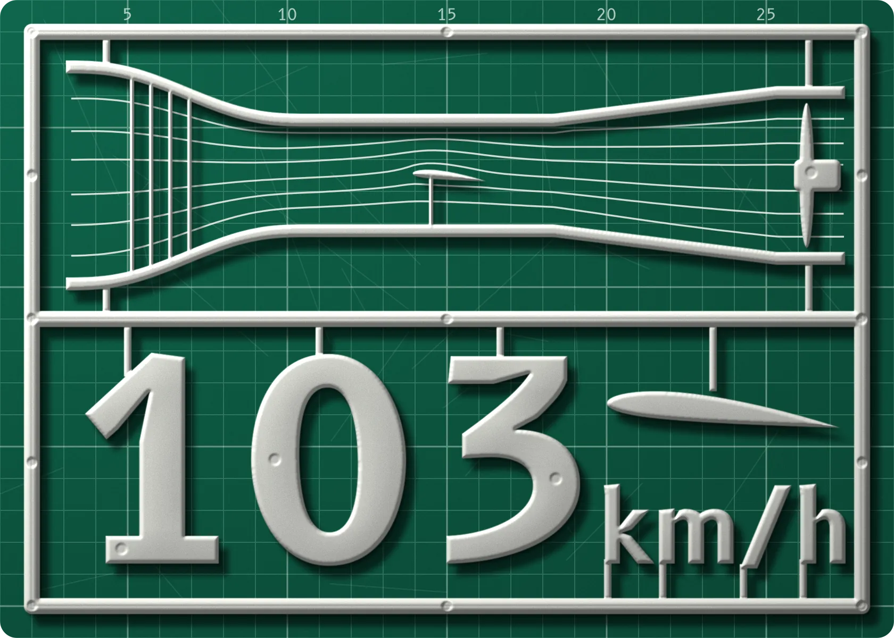
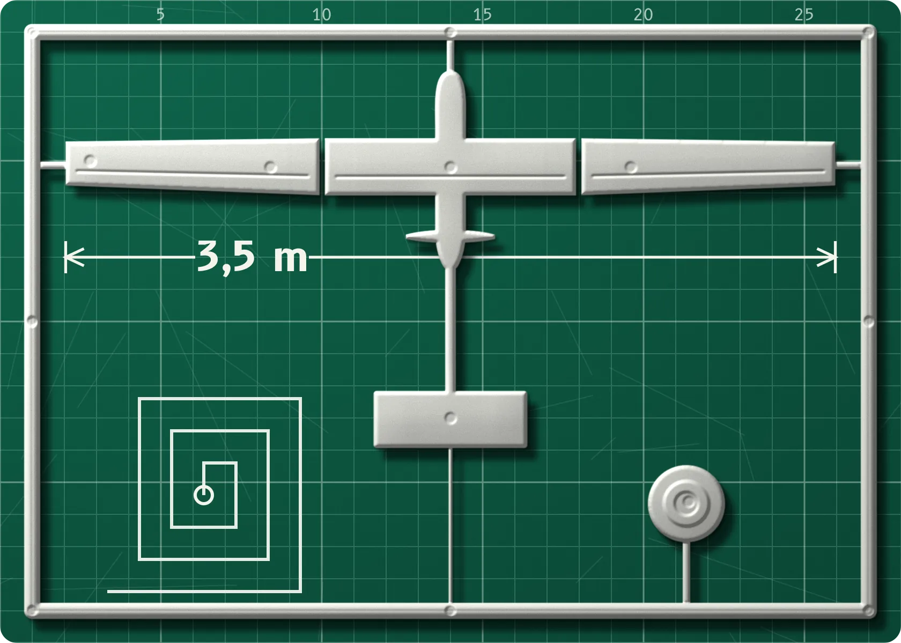
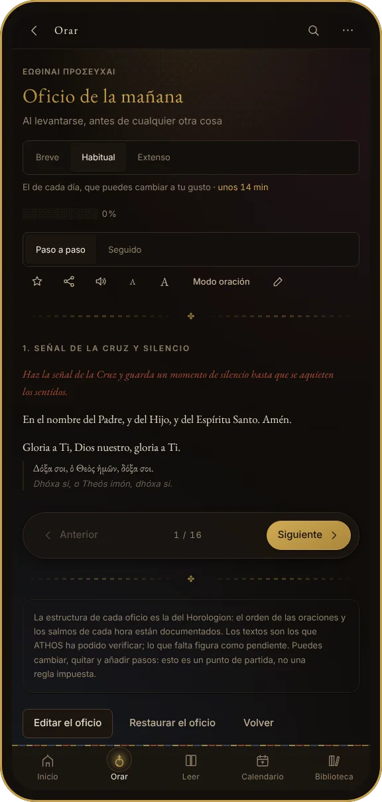
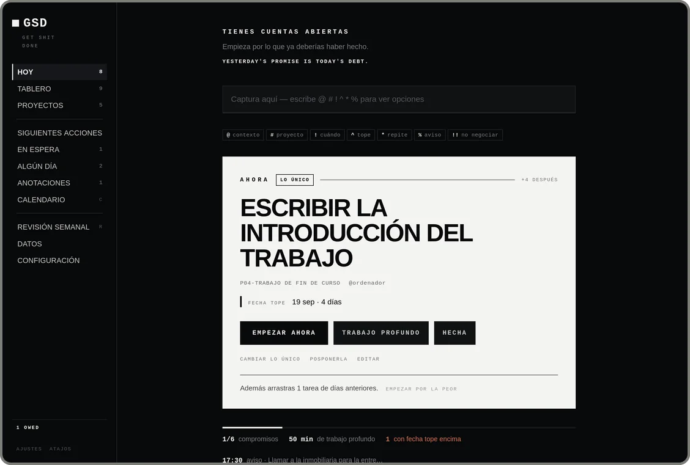

<h1 align="center">Soy Toms Esto es lo que tengo ahora en la mesa</h1>

<b>Túnel de viento.</b> Abierto, de succión y creado por mí. Su récord son <b>103 km/h</b>, y sirve para ensayar perfiles como un NACA 2412 impreso en 3D.

<b>UAV para búsqueda y rescate.</b> Un avión sin piloto para encontrar a gente perdida. 
<kbd>3,5 m</kbd> <kbd>6,5 kg</kbd> <kbd>5 h de autonomía objetivo</kbd> <kbd>LW-PLA</kbd> <kbd>cámara térmica</kbd>

<b>Carreras FPV.</b> Drones que se pilotan con gafas, viendo lo que ve su cámara. El mío es un OpenRacer de 5 pulgadas.

<h2 align="center">Y además programo</h2>

<b><a href="https://github.com/Tomasito25/QB-Bachillerato-Internacional">QuestionBank</a></b> · banco de preguntas colaborativo, sin servidores · <a href="https://tomasito25.github.io/QB-Bachillerato-Internacional/">abrir</a> 
<b><a href="https://github.com/Tomasito25/athos">ATHOS</a></b> · oraciones, Biblia y calendario litúrgico ortodoxo · <a href="https://tomasito25.github.io/athos/">abrir</a> 
<b><a href="https://github.com/Tomasito25/Get-Shit-Done">GSD</a></b> · tus tareas y, en grande, la única que importa hoy

React · TypeScript · Node.js · GitHub Actions · impresión 3D

